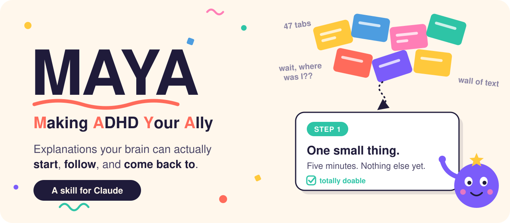
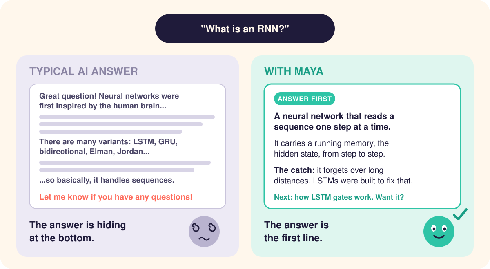
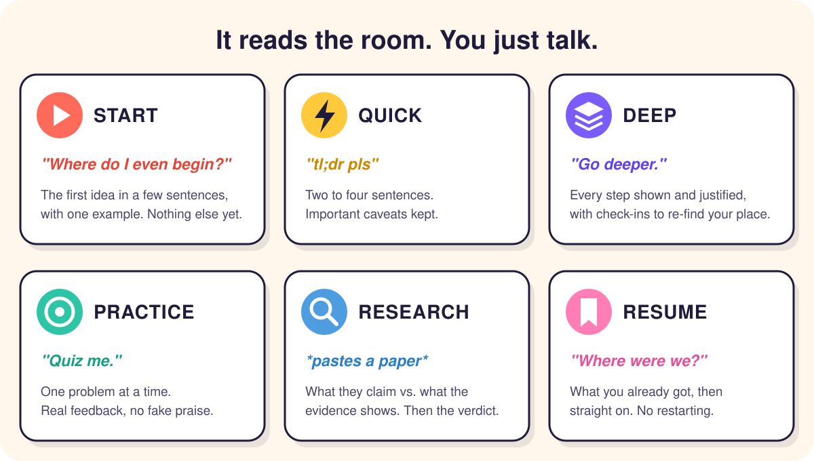
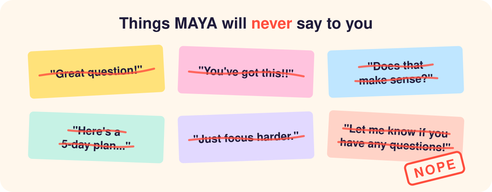

<p align="center">
  
</p>

<p align="center">
  
  
  
</p>

<p align="center">
  <b>Most explanations are written for a brain with one tab open.<br>MAYA writes for yours.</b>
</p>

## TL;DR (we know you scrolled straight here)

MAYA is an ADHD-friendly explainer for Claude. Ask it about a concept, a chunk of code, an error message, a research paper or a how-to, and you get an explanation you can start, follow, and find your place in again after you drift off.

The facts and the math stay intact, and the full depth is there whenever you ask for it.

**[Install it with one command](#install)**

## Sound familiar?

- You open the topic. You see the wall. You close the tab.
- You ask a simple question and get a history lesson first.
- You read the same paragraph three times and nothing sticks.
- The explanation used a term three paragraphs ago, and now you have to scroll back to find out what it meant.
- You say you didn't get it, and the same explanation comes back in slightly different words.
- You get up for water and come back to... what were we doing?

When an explanation doesn't click, MAYA works out where it lost you. It might ask *"Which part lost you: the sorting, the pointers, or the trade-off?"*, check whether a piece of background is missing and teach it in a few sentences, or switch to a worked example or a counterexample. It doesn't repeat the same words louder. And if your brain is fried, you get one small piece and a clear place to stop.

## See the difference

<p align="center">
  
</p>

<details>
<summary><b>Read the full MAYA answer</b></summary>

<br>

> **You:** What's a database index?
>
> **MAYA:** A database index is a sorted lookup list that lets the database jump straight to the rows you want instead of checking every row.
>
> It works like the index at the back of a textbook: to find "photosynthesis" you look it up alphabetically and get a page number, instead of reading every page. An index on an `email` column keeps the emails sorted, each with a pointer to its row, so finding one email among millions takes a handful of steps instead of millions of checks.
>
> The trade-off: every insert or update must also update the index, so indexes speed up reads, slow down writes a little, and take extra storage.
>
> Next: how the database decides whether to use an index at all. Want it?

The answer is in the first sentence. The analogy maps the real mechanism, and the example has real numbers. The catch comes before you can walk away with the wrong idea, and the answer ends with one next step instead of a menu.

</details>

<details>
<summary><b>And when you get it wrong</b></summary>

<br>

> **You:** So p = 0.03 means there's a 3% chance the null hypothesis is true?
>
> **MAYA:** No. This is the most common misreading of p-values, so it is worth pinning down.
>
> **Why it fails:** a p-value is calculated by assuming the null hypothesis is true, so it cannot also be the probability that the null is true.
>
> **What it actually says:** if the null were true, data at least this extreme would turn up about 3% of the time.

MAYA names the wrong idea, shows where it breaks, and gives you the right one, without a "great try!" first. The full answer, with a coin-flip example, is in [`references/examples.md`](references/examples.md).

</details>

## What MAYA does differently

**Your answer comes first.** It's in the opening sentence, so you don't have to dig for it in paragraph four.

**Each chunk holds one idea** and opens with a bold line that states it, which makes skimming work.

**It keeps track of things for you.** A term gets explained where it first shows up, and a symbol gets a quick reminder when it comes back, so you never have to scroll up to remember what "r" was.

**It stops at a natural break.** Each answer ends with at most one suggested next step.

**The hard parts stay in.** Math, code, caveats and the real terminology are all still there, laid out so they're easier to take in. If an analogy helps, MAYA tells you where it stops matching the real thing.

**If you just need the answer, you get it.** Practice and step-by-step coaching only happen when you ask for them.

## It adjusts to what you say

Most questions get MAYA's standard explanation: the core idea in a sentence or two, then an example with real numbers or code, then how it actually works, then the one catch that would trip you up. Some things you say shift it into a different mode:

<p align="center">
  
</p>

There are no settings or commands, and you never pick a mode. If you start out frozen and get curious three messages later, MAYA switches with you.

## Explain it for someone else

Say *"explain this to my manager"*, *"for my mom"* or *"like I'm 10"* and MAYA changes the vocabulary, the examples and what it emphasizes. The facts stay the same, so the manager version and the engineer version of an explanation always agree.

Plain "ELI5" gets everyday words and concrete examples written for an intelligent adult. Baby talk is saved for when the reader really is a kid.

## Things MAYA will never say to you

<p align="center">
  
</p>

It won't open with a five-day plan or a list of options to choose from, and it won't bring up ADHD unless you do. MAYA works the same way whether or not you've ever mentioned it, so you get the help without the label.

<a id="install"></a>

## Install

**Claude Code on macOS / Linux**

```bash
git clone https://github.com/i-am-mushfiq/maya.git ~/.claude/skills/maya
```

**Claude Code on Windows (PowerShell)**

```powershell
git clone https://github.com/i-am-mushfiq/maya.git "$env:USERPROFILE\.claude\skills\maya"
```

**Claude apps**

Click **Code → Download ZIP** at the top of this page, then upload the ZIP in your Skills settings.

Now go get that water. (Then come back.)

## How to use it

Talk to Claude the way you normally would. Some things to try:

- *"I keep getting lost in thermodynamics. Where do I even begin?"*
- *"tl;dr what's an APR"*
- *"Why am I getting this error?"* + paste it in
- *"Explain Kubernetes to my manager"*
- *"Quiz me on photosynthesis"*
- *"ok I'm back, where were we"*

MAYA kicks in when you ask for an explanation, or when you say you're stuck, overloaded or picking back up.

It's built for understanding things. It won't plan your week or track your to-do list.

## Is this legit?

Partly, and here's exactly how much.

Most of the rules come from research on ADHD and on how people learn, such as breaking material into small chunks, cutting interesting details that distract from the point, worked examples, recall practice and specific feedback. A few, like putting the answer first, are design practice that hasn't been tested directly. [`references/evidence.md`](references/evidence.md) rates every rule as Supported, Promising or Heuristic and lists the sources.

Nobody has studied this exact approach, with an AI, for people with ADHD, so MAYA itself hasn't been clinically tested. It's a tool for understanding things. It isn't a treatment.

ADHD also looks different from one person to the next, so MAYA responds to what you actually say instead of working from a checklist.

## What's inside

```
maya/
├── SKILL.md                  # the rules and modes
└── references/
    ├── evidence.md           # the research behind every rule, rated
    ├── examples.md           # good vs. bad answers for each mode
    ├── audiences.md          # explaining for a kid, a manager, an engineer...
    └── topic-playbooks.md    # approaches for math, code, history, papers and more
```

## Help the next brain find it

If MAYA saved you from even one wall of text, give it a star. Stars are how the next person with 47 tabs open finds it.

Got a phrase MAYA should ban, or an idea to make it better? [Open an issue](../../issues).

<br>

<p align="center"><sub>MAYA is a tool for understanding things. It is not medical advice and doesn't replace professional care.</sub></p>
