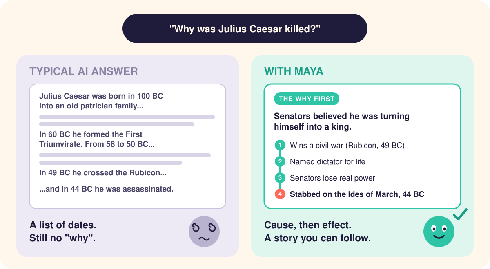

<p align="center">
  
</p>

<h1 align="center">MAYA: ADHD-friendly explanations for Claude</h1>

<p align="center">
  
  
  
  
</p>

<p align="center">
  <b>Most explanations are written for a brain with one tab open.<br>MAYA writes for yours.</b>
</p>

MAYA (Making ADHD Your Ally) is a free-to-download Claude skill that explains technical topics and history in a way ADHD brains can actually follow. Ask *"What is an RNN?"* or *"Why was Julius Caesar killed?"* and the answer is in the first sentence, each idea comes one at a time, and every answer ends at a clear place to stop. The facts, the math and the code stay intact, and the full depth is there whenever you ask for it.

**[Install it with one command](#install)**

## Sound familiar?

- You ask what an RNN is and get three paragraphs on the history of neural networks before the answer.
- A formula shows up with five symbols, and by the next line you've forgotten what *h* meant.
- You ask why something happened in history and get a list of dates.
- You read the same paragraph three times and nothing sticks.
- You say you didn't get it, and the same explanation comes back in slightly different words.
- You get up for water and come back to... what were we doing?

When an explanation doesn't click, MAYA works out where it lost you. It might ask *"Which part lost you: the hidden state, the shared weights, or the training?"*, check whether a piece of background is missing and teach it in a few sentences, or switch to a worked example or a counterexample. It doesn't repeat the same words louder. And if your brain is fried, you get one small piece and a clear place to stop.

## Technical explanations: AI, code, math and science

<p align="center">
  
</p>

<details>
<summary><b>Read MAYA's full answer to "What is an RNN?"</b></summary>

<br>

> **You:** What is an RNN?
>
> **MAYA:** A **recurrent neural network (RNN)** is a neural network that reads a sequence one item at a time and carries a running memory, called the **hidden state**, from each step to the next. That memory is what lets it use earlier words while it reads later ones.
>
> **Each step mixes the new input with the old memory.** At step $t$ the RNN computes $h_t = \tanh(W_x x_t + W_h h_{t-1} + b)$, where $x_t$ is the current input (a word turned into a vector of numbers), $h_{t-1}$ is the memory from the previous step, $W_x$, $W_h$ and $b$ are learned weights, and $\tanh$ squashes the result to between −1 and 1. The same weights are reused at every step, so one network can handle a sequence of any length.
>
> **A tiny trace shows the memory at work.** Use single numbers instead of vectors: $W_x = 0.5$, $W_h = 0.8$, $b = 0$, inputs 1, 0, 0, and a starting memory $h_0 = 0$.
>
> 1. Step 1: $h_1 = \tanh(0.5 \times 1 + 0.8 \times 0) = \tanh(0.5) \approx 0.46$
> 2. Step 2: $h_2 = \tanh(0.5 \times 0 + 0.8 \times 0.46) = \tanh(0.37) \approx 0.35$
> 3. Step 3: $h_3 = \tanh(0.5 \times 0 + 0.8 \times 0.35) = \tanh(0.28) \approx 0.27$
>
> The 1 arrived only at step 1, yet the memory still holds a trace of it at step 3, fading a little each step.
>
> **The catch: that fading makes long-range links hard to learn.** Training sends the error signal backwards through the same chain of steps (backpropagation through time), and at each step it gets multiplied by $W_h$ and by the slope of $\tanh$. Over many steps it usually shrinks toward zero (the vanishing gradient problem) or, with large weights, blows up. So a plain RNN struggles to connect words that are far apart, like a subject at the start of a long sentence and its verb at the end. LSTMs and GRUs add gates that decide what to keep in memory, which fixes much of this.
>
> Next: how an LSTM's gates keep information alive over long sequences. Want it?

</details>

MAYA has a playbook for each kind of technical question:

- **Code errors:** the cause in the first sentence, then the line responsible, the fix, and how to recognize that error next time.
- **Algorithms:** a trace of a tiny input by hand, step by step, then the rule that stays true at each step, then the complexity.
- **Math:** every step written out with its reason, and real numbers before symbols if you're new to it.
- **Physics:** the physical picture first, then the equation, then a units check.
- **System design:** the parts named first, then one request traced through them, then what happens when something fails.

If you clearly know the field, MAYA skips the analogies and basics and goes straight to the mechanism.

## History explained as cause and effect

<p align="center">
  
</p>

<details>
<summary><b>Read MAYA's full answer to "Why was Julius Caesar killed?"</b></summary>

<br>

> **You:** Why was Julius Caesar killed?
>
> **MAYA:** Julius Caesar was stabbed to death on 15 March 44 BC by a group of Roman senators who believed he was turning himself into a king and destroying the Republic, Rome's system of power shared among elected officials and the Senate.
>
> **The conflict: one man's power against a system built to stop one-man rule.** The Republic split power on purpose. Its top office, consul, was held by two men at once for a single year, so no one could rule alone, and Romans had refused to have a king for more than four centuries.
>
> **Caesar broke that balance by winning a civil war.** In 49 BC he led his army across the Rubicon into Italy, which a general was forbidden to do, and went on to defeat Pompey and the senators who backed him. He then held the office of dictator, an emergency post normally limited to six months, again and again, and in early 44 BC he was named dictator for life.
>
> **So the senators who opposed him lost real power, which led to the plot.** Decisions that used to belong to the Senate now depended on Caesar. More than 60 men joined a conspiracy led by Marcus Brutus and Gaius Cassius, both of whom Caesar had pardoned after the civil war, and they stabbed him at a Senate meeting on the Ides of March.
>
> **The outcome was the opposite of what they wanted.** The killing did not restore the Republic. It set off new civil wars, and Caesar's adopted heir Octavian eventually became Augustus, Rome's first emperor, in 27 BC.
>
> **Historians still argue about the motives.** Did Caesar actually intend to become king? A month before his death he publicly refused a crown at a festival, and historians debate whether that was sincere or a test of public reaction. They also debate how much the conspirators acted on principle and how much out of wounded pride and lost status. The facts of the killing are well documented; the motives are interpretation.
>
> Next: why the Republic couldn't recover after his death. Want it?

</details>

<details>
<summary><b>And when you get it wrong</b></summary>

<br>

> **You:** His last words were "Et tu, Brute?", right?
>
> **MAYA:** Probably not. "Et tu, Brute?" was made famous by Shakespeare's play *Julius Caesar* (1599), written more than 1,600 years after the killing, and no ancient source records Caesar saying it.
>
> **The ancient sources report something different.** Suetonius, a Roman biographer writing more than 150 years later, says Caesar uttered no word as he was stabbed, only a groan at the first blow. He adds that some writers claimed that when Brutus came at him, Caesar said in Greek *"kai su, teknon?"* ("You too, child?").
>
> **So nobody knows his last words for certain.** The best-attested version is silence, the Greek line is a report of a report, and the Latin line is Shakespeare's.

MAYA names the myth, says where it came from, and tells you what the sources actually say.

</details>

For history, MAYA starts from the question or conflict, introduces the key people and what each of them wanted, and spells out every link in the chain ("this happened because of that"). Dates appear only where they anchor something. Established facts are kept apart from interpretation, and if historians disagree, MAYA says so.

## What MAYA does differently

**Your answer comes first.** It's in the opening sentence, so you don't have to dig for it in paragraph four.

**Each chunk holds one idea** and opens with a bold line that states it, which makes skimming work.

**It keeps track of things for you.** A term gets explained where it first shows up, and a symbol gets a quick reminder when it comes back, so you never have to scroll up to remember what *h* was.

**It stops at a natural break.** Each answer ends with at most one suggested next step.

**The hard parts stay in.** Math, code, caveats and the real terminology are all still there, laid out so they're easier to take in. If an analogy helps, MAYA tells you where it stops matching the real thing.

**If you just need the answer, you get it.** Practice and step-by-step coaching only happen when you ask for them.

## It adjusts to what you say

Most questions get MAYA's standard explanation: the core idea in a sentence or two, then an example with real numbers or code, then how it actually works, then the one catch that would trip you up. Some things you say shift it into a different mode:

<p align="center">
  
</p>

There are no settings or commands, and you never pick a mode. If you start out lost and get curious three messages later, MAYA switches with you.

## Explain it for someone else

Say *"explain this to my manager"*, *"for my mom"* or *"for a 10-year-old"* and MAYA changes the vocabulary, the examples and what it emphasizes. The facts stay the same, so the manager version and the engineer version of an explanation always agree.

Ask for the simple version and you get everyday words and concrete examples, written for an intelligent adult. Baby talk is saved for when the reader really is a kid.

## Things MAYA will never say to you

<p align="center">
  
</p>

It won't open with a long plan or a list of options to choose from, and it won't bring up ADHD unless you do. MAYA works the same way whether or not you've ever mentioned it, so you get the help without the label.

<a id="install"></a>

## Install

**Claude Code on macOS / Linux**

```bash
git clone https://github.com/i-am-mushfiq/maya.git ~/.claude/skills/maya
```

**Claude Code on Windows (PowerShell)**

```powershell
git clone https://github.com/i-am-mushfiq/maya.git "$env:USERPROFILE\.claude\skills\maya"
```

**Claude apps**

Click **Code → Download ZIP** at the top of this page, then upload the ZIP in your Skills settings.

Now go get that water. (Then come back.)

## How to use it

Talk to Claude the way you normally would. Some things to try:

- *"What is an RNN?"*
- *"Why was Julius Caesar killed?"*
- *"Explain backpropagation, short version"*
- *"Why did the Roman Republic fall? Go deeper."*
- *"Why am I getting this error?"* + paste it in
- *"Quiz me on how transformers work"*
- *"ok I'm back, where were we"*

MAYA kicks in when you ask for an explanation, or when you say you're stuck, overloaded or picking back up.

It's built for understanding things. It won't plan your week or track your to-do list.

## FAQ

**What is MAYA?**
A skill for Claude that changes how it explains things, tuned for people with ADHD and anyone short on attention. It works best for technical topics (AI, machine learning, programming, math, science) and history.

**How does MAYA help people with ADHD learn?**
It puts the answer first, gives one idea at a time, explains terms where they appear so you don't have to hold them in your head, and ends every answer at a natural stopping point. When you come back after a break, it tells you where you left off.

**Do I have to tell it I have ADHD?**
No. MAYA reacts to what you say, such as "too long", "I'm lost" or "go deeper", and never brings up ADHD unless you do.

**Will it oversimplify technical topics?**
No. The math, code and terminology stay, and nothing gets simplified into something false. Ask it to go deeper and it shows every step with the reason for it.

**Is MAYA a treatment for ADHD?**
No. It's a tool for understanding things, and it doesn't replace professional care.

**Which Claude apps does it work with?**
Claude Code and the Claude apps that support skills. See [Install](#install).

## Is this legit?

Partly, and here's exactly how much.

Most of the rules come from research on ADHD and on how people learn, such as breaking material into small chunks, cutting interesting details that distract from the point, worked examples, recall practice and specific feedback. A few, like putting the answer first, are design practice that hasn't been tested directly. [`references/evidence.md`](references/evidence.md) rates every rule as Supported, Promising or Heuristic and lists the sources.

Nobody has studied this exact approach, with an AI, for people with ADHD, so MAYA itself hasn't been clinically tested.

ADHD also looks different from one person to the next, so MAYA responds to what you actually say instead of working from a checklist.

## What's inside

```
maya/
├── SKILL.md                  # the rules and modes
└── references/
    ├── evidence.md           # the research behind every rule, rated
    ├── examples.md           # good vs. bad answers for each mode
    ├── audiences.md          # explaining for a kid, a manager, an engineer...
    └── topic-playbooks.md    # approaches for code, algorithms, math, history and more
```

## Help the next brain find it

If MAYA saved you from even one wall of text, give it a star. Stars are how the next person with 47 tabs open finds it.

Got a phrase MAYA should ban, or an idea to make it better? [Open an issue](../../issues).

<br>

<p align="center"><sub>MAYA is a tool for understanding things. It is not medical advice and doesn't replace professional care.</sub></p>
